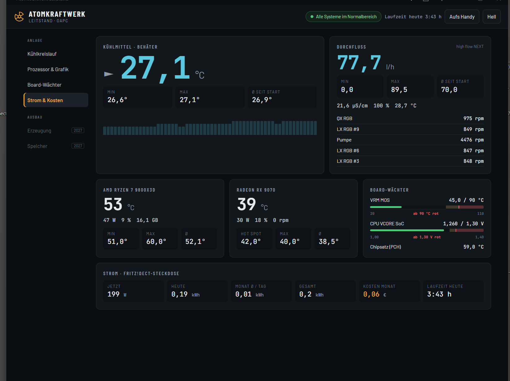
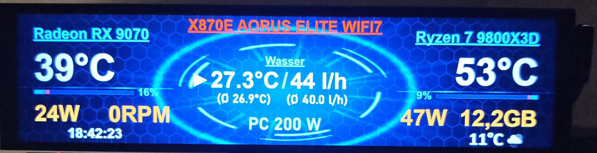

# Atomkraftwerk – Leitstand für den eigenen PC

Ein kleines Windows-Programm sammelt jede Sekunde die wichtigen Werte eines wassergekühlten PCs und zeigt sie als Leitstand im Browser an, am PC und am Handy im Heimnetz.

- **Kühlung:** Wassertemperatur, Pumpe und Lüfter aus der iCUE-Sensorprotokollierung, mit Trendpfeil und 30-Minuten-Verlauf
- **Durchfluss:** Aquacomputer high flow NEXT über USB (l/h, Leitfähigkeit, Wasserqualität, Temperatur)
- **Prozessor & Grafik:** Temperatur, Leistung, Last, RAM (über LibreHardwareMonitor)
- **Board-Wächter:** VRM-Temperatur und SoC-Spannung mit gelber/roter Grenze
- **Strom:** FRITZ!DECT-200-Steckdose über die FRITZ!Box – Watt jetzt, Verbrauch heute, Ø pro Tag im Monat, Gesamt, Kosten (Standby zählt mit)
- **Auswertung:** beliebigen Tag wählen, bis zu drei Werte als Kurve übereinander, Min/Max/Ø mit Uhrzeit, Spitzen des Tages
- Min / Max / Ø für jeden Wert, Hell/Dunkel, QR-Code zum Öffnen am Handy, Hinweise per Maus-Tooltip
- Dazu ein **InfoPanel-Plugin**, das Durchfluss, Ø-Durchfluss und PC-Watt auf ein InfoPanel-Display bringt

Alle Werte werden minütlich in `daten\JJJJ-MM-TT.csv` abgelegt.

## Voraussetzungen

- Windows 10/11, **.NET 8 Runtime** (die normale „.NET Runtime" reicht)
- Programm braucht Administratorrechte (für die Board-Sensoren)
- Optional: iCUE mit eingeschalteter Sensorprotokollierung, Aquacomputer high flow NEXT, FRITZ!Box mit FRITZ!DECT 200

## Einrichten

1. `release/Atomkraftwerk.zip` herunterladen und in einen festen Ordner entpacken, z. B. `C:\Atomkraftwerk`
2. `atomkraftwerk.json` mit dem Editor öffnen und anpassen (siehe unten)
3. **„Autostart einrichten.bat"** doppelklicken – das Programm startet sofort und künftig bei jeder Anmeldung (unsichtbar, über die Aufgabenplanung)
4. Leitstand im Browser: <http://localhost:8090> (oder `Leitstand.url`)
5. Fürs Handy: **„Handy freigeben.bat"** (Firewall-Freigabe nur im privaten Netz), dann im Leitstand auf **„Aufs Handy"** und den QR-Code scannen

Beenden: **„Atomkraftwerk beenden.bat"** · Autostart wieder weg: **„Autostart entfernen.bat"** · Zum Testen mit Fenster: **„Atomkraftwerk starten.bat"**

## Einstellungen (`atomkraftwerk.json`)

| Eintrag | Bedeutung |
|---|---|
| `port` | Port des Leitstands (Standard 8090) |
| `icueOrdner` | Ordner der iCUE-Protokolldateien, leer = Dokumente |
| `grenzen` | Warn- und Alarmgrenzen (VRM, SoC, CPU, GPU-Hotspot, Wasser, Durchfluss) |
| `strompreisCentProKWh` | Strompreis für die Kostenanzeige |
| `fritz.adresse` | Adresse der FRITZ!Box, meist `http://fritz.box` |
| `fritz.benutzer` / `fritz.kennwort` | eigener FRITZ!Box-Benutzer, der **nur** das Recht „Smart Home" hat |
| `fritz.ain` | AIN der Steckdose (FRITZ!Box → Smart Home → Gerät → Allgemein), ohne Leerzeichen |

Das Kennwort steht nur in dieser Datei auf dem eigenen PC – **nie mit hochladen**.

## InfoPanel-Plugin

`release/InfoPanel.Atomkraftwerk.zip` nach `C:\ProgramData\InfoPanel\plugins\` entpacken und InfoPanel neu starten. Das Plugin holt alle 2 Sekunden die Werte vom laufenden Atomkraftwerk und liefert:

| Plugin-Wert | Beispiel |
|---|---|
| Durchfluss (Anzeige) | `49 l/h` |
| Durchfluss Ø (Anzeige) | `(Ø 65.3 l/h)` |
| PC Leistung (Anzeige) | `PC 195 W` |

Zusätzlich die gleichen Werte als Zahlen-Sensoren. Für die Wassertemperatur mit Trendpfeil gibt es das Schwester-Plugin [InfoPanel.iCUE](https://github.com/OA-Creator/InfoPanel.iCUE).

## Selbst bauen

- Programm: die DLLs aus dem InfoPanel-Programmordner nach `Programm\lib` kopieren (Liste in `lib\LIESMICH.txt`), dann `dotnet build -c Release` im Ordner `Programm`
- Plugin: braucht den Quellcode von InfoPanel daneben (`..\..\infopanel`) oder `-p:InfoPanelSrc=<Pfad>`

## Hinweise

- Die Board-Sensoren sind für das **Gigabyte X870E Aorus Elite WiFi7 (ITE IT8696E)** zugeordnet (`Quellen.cs`). Andere Boards brauchen eine eigene Zuordnung.
- Die Laufzeit zählt nur, solange das Programm läuft; der Stromverbrauch kommt aus der FRITZ!Box und zählt auch bei ausgeschaltetem PC.
- Enthält [LibreHardwareMonitorLib](https://github.com/LibreHardwareMonitor/LibreHardwareMonitor) (MPL 2.0) und HidSharp (Apache 2.0) im Release-Zip.

## Lizenz

MIT – siehe [LICENSE](LICENSE).
